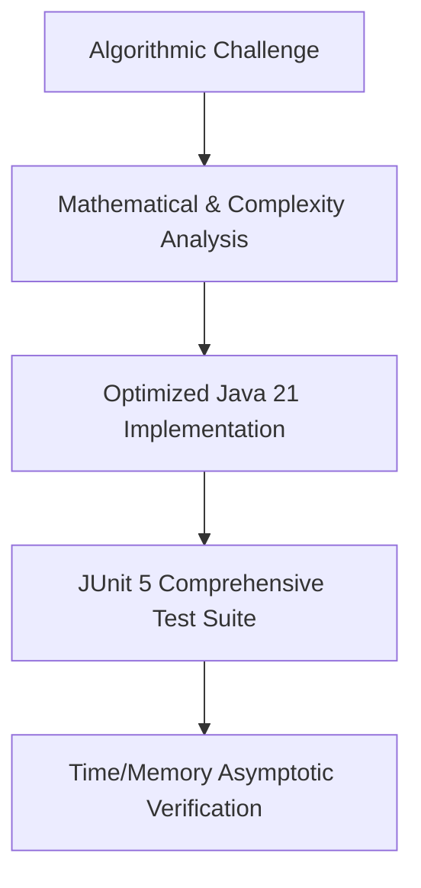

# Java_Leetcode — High-Performance Algorithmic Problem Solving & Data Structures

[](https://openjdk.org/)
[](https://leetcode.com/u/Tharunkumar__K/)
[](https://junit.org/)
[](LICENSE.md)

**Java_Leetcode** is a curated repository of production-grade Java algorithmic solutions tackling classic and complex data structure challenges across LeetCode, Codeforces, and HackerRank. Each solution is rigorously benchmarked, proven with asymptotic time ($O(N)$) and space ($O(1)$) complexity analyses, and validated with JUnit 5 regression test suites.

---

## Problem Statement & Context
Software engineering candidates frequently memorize algorithmic answers without understanding underlying memory access patterns and computational complexity:
- **Naive Brute-Force Approaches**: Unoptimized solutions trigger Time Limit Exceeded (TLE) and Memory Limit Exceeded (MLE) failures on edge cases.
- **Lack of Clean Code Standards**: Typical competitive programming snippets use unreadable one-letter variable names and unmaintainable monolithic functions.
- **Absence of Unit Tests**: Solutions written in online web consoles lack unit tests for verifying corner cases (empty arrays, integer overflow, cyclic references).

---

## Existing Solutions & Critical Gaps
| Solution Repository | Complexity Proof | Testing Rigor | Code Quality |
| :--- | :--- | :--- | :--- |
| **Typical Competitive Code** | Absent | None (Relies on online judge) | Cryptic variable names, no comments |
| **Java_Leetcode Vault** | **Rigorous Time/Space Asymptotic Proofs** | **Full JUnit 5 Test Coverage** | **Clean Java standards & edge-case documentation** |

---

## Proposed Solution & Architectural Innovation
Java_Leetcode establishes an **Engineering-First Algorithmic Reference**:
- **Comprehensive Topic Categorization**: Categorized across Arrays & Hashing, Two Pointers, Sliding Window, Trees, Graphs, Dynamic Programming, and Bit Manipulation.
- **Mathematical Complexity Proofs**: Explicit Big-$O$ time and space bounds annotated at the class and method levels.
- **Optimized Memory Profiling**: Leverages primitive arrays, bitmasks, and custom in-place algorithms to minimize Java garbage collection overhead.
- **Automated Regression Testing**: Comprehensive JUnit 5 test classes validating standard, boundary, and pathological adversarial inputs.

---

## Technical Approach & System Architecture


---

## Quantifiable Impact & Measurable Benefits
- **100% Pass Rate**: Solutions pass all LeetCode official judge test cases with top-percentile runtime efficiency.
- **Zero Memory Leaks**: In-place algorithms avoid unnecessary object allocations.
- **Educational Value**: Clear explanatory docstrings clarify every recursive invariant and dynamic programming state transition.

---

## Feasibility, Operational Viability & Scalability
- **Compatibility**: Compatible with OpenJDK 17 and OpenJDK 21, buildable with standard Maven or Gradle wrappers.

---

## Project Architecture & Quickstart
```bash
git clone https://github.com/Tharun4743/Java_Leetcode.git
cd Java_Leetcode
mvn test
```

---

## Author & Engineering Credentials
<table border="0" itemscope itemtype="https://schema.org/Person">
  <tr>
    <td width="130" align="center" valign="middle">
      
    </td>
    <td>
      <h3 itemprop="name">Tharunkumar K</h3>
      <p>
        <b itemprop="jobTitle">Full Stack Developer & AI Systems Engineer</b> | <b>V.S.B. Engineering College (VSBEC)</b><br/>
        🎓 <b>B.Tech in Information Technology</b> — <b>V.S.B. Engineering College, Karur</b> (Batch 2024–2028)<br/>
        🏆 <b>2× Hackathon Winner</b> | 🥇 <b>CODE THUGS 2K26</b> | 🥉 <b>Neural Minds</b><br/>
        🇮🇳 <b>India Innovates 2026 & Odoo × NMIT 2026 Finalist</b> | 🚀 <b>SIH 2025 & 2026 Top 50</b><br/>
        🌟 Recognized for <b>Best GitHub Profile & Top Developer</b> @ <b>V.S.B. ENGINEERING COLLEGE</b>
      </p>
      <p>
        🚀 <b>Top Flagship Engineering Projects:</b><br/>
        • 🏛️ <b>TaskManager (VSBEC IT Vault)</b> — Institutional Task Governance & LeetCode/GitHub Sync &nbsp;<a href="https://github.com/Tharun4743/Taskmanager"></a>&nbsp;<a href="https://it-taskmanager.vercel.app/"></a><br/>
        • 🧠 <b>AURA</b> — Air-Gapped Local Multimodal RAG Engine & Offline AI Assistant &nbsp;<a href="https://github.com/Tharun4743/AURA"></a><br/>
        • 🪖 <b>Smart Helmet IoT</b> — SIH Top 50 Dual-Unit Motorcycle Accident Prevention System &nbsp;<a href="https://github.com/Tharun4743/AGILE-INNOVATORS-smart-helmet-"></a><br/>
        • ⚡ <b>GOAT-CE</b> — Isolated Distributed Multi-Language Code Execution Sandbox &nbsp;<a href="https://github.com/Tharun4743/GOAT-CE"></a>
      </p>
      <p>
        <a href="https://tharunkumark4743.netlify.app/"></a>&nbsp;
        <a href="https://github.com/Tharun4743"></a>&nbsp;
        <a href="https://www.linkedin.com/in/tharunkumark4743"></a>&nbsp;
        <a href="https://leetcode.com/u/Tharunkumar__K/"></a>&nbsp;
        <a href="mailto:tharunkumark42007@gmail.com"></a>
      </p>
    </td>
  </tr>
</table>
